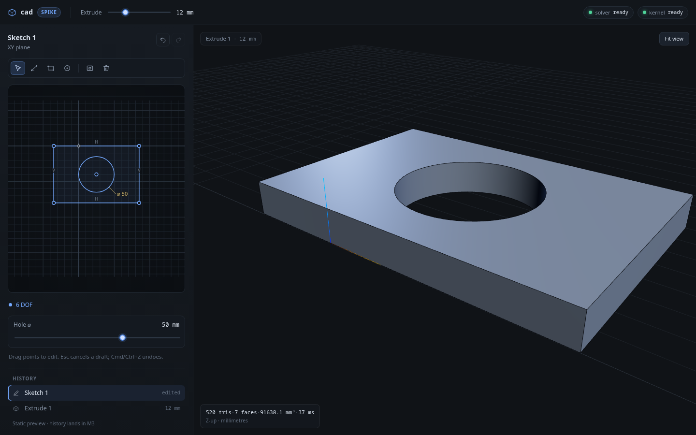

# cad

A browser-based parametric CAD app: constrained 2D sketches → 3D features → an editable
history, including sketches made on faces of the resulting solid.

Think "the core loop of Fusion 360", not a mesh editor.



## Run it

```bash
nvm use          # Node from .nvmrc
npm install
npm run dev
```

The first load pulls ~1.6 MB gzip of solver and ~7 MB gzip of OCCT. Both load lazily;
the app shows `solver ready` / `kernel ready` badges when they are up.

```bash
npm run verify   # typecheck + lint + unit tests
npm run e2e      # Playwright: exact-volume smoke test
npm run build
```

## What works today

The main stage toggles between the **model** and a full-stage **sketch editor** via the
timeline at the bottom. Sketch mode has a floating tool strip, a DOF pill, and a floating
selection/dimension inspector; there is no permanent sidebar.

- Draw with the **line**, **rectangle**, **circle**, and **three-point arc** tools.
  Grid and point snapping; axis inference adds horizontal/vertical constraints; chains
  close on their first point. Select two adjacent lines to round the corner with a
  parametric **fillet**.
- Drag points, whole lines, circles, and arcs: the cursor delta is projected onto the
  constraint tangent space, so points slide along lines and circles and lines translate
  (or stretch, if their endpoints are constrained differently). Fully constrained
  geometry refuses to move.
- Dimension distances, point-to-line distances, angles, diameters, and radii; driving or
  reference; double-click to edit and drag the label to reposition it. The floating
  constraint bar adds perpendicular/parallel/equal/tangent/symmetric/midpoint/point-on-
  line/point-on-circle/coincident/fix and toggles construction geometry.
- A selectable fixed **origin and X/Y axes** are always available for constraints and
  dimensions. Select a point to type exact **X/Y** coordinates; the same constraint
  projection as dragging applies.
- Extrude any closed region: a plate, a cylinder from a lone circle, a tube from two
  concentric circles, an arbitrary face with nested cutouts, or a mixed line/arc profile.
  Arc edges stay exact through the kernel. OCCT runs in a Web Worker; three.js renders the
  solid with its B-rep edges (Z-up, mm).
- **Select and delete**: click a curve or point, Shift-click to multi-select, Delete to
  remove. Deletion cascades through dependent curves/constraints; undo restores it.
- **Undo/redo** with gesture grouping (`Cmd/Ctrl+Z`, `Shift+Cmd/Ctrl+Z`), `Esc` to cancel a
  draft and clear the selection, `V/L/R/C/A/D` for tools.
- Exact volume/face/triangle stats, and e2e tests that check them numerically while
  dragging, dimensioning, drawing, selecting/deleting, and undoing.

It is intentionally narrow: profile selection is still "largest closed loop", datum planes
and sketches on faces are M4, the feature tree is a preview, and nothing is persisted yet.
See `docs/PLAN.md` for what comes next.

## The stack in one line

TypeScript + React + three.js in the browser; SolveSpace's `slvs` as the 2D constraint
solver; OCCT (via `brepjs` + `occt-wasm`) in a Web Worker as the B-rep kernel.

Because `slvs` is GPLv3, this project is GPLv3.

## Docs

- [`AGENTS.md`](AGENTS.md) — stack, invariants, conventions, commands, gotchas
- [`docs/ARCHITECTURE.md`](docs/ARCHITECTURE.md) — how it works and why
- [`docs/PLAN.md`](docs/PLAN.md) — milestones and the next concrete tasks
- [`docs/decisions/`](docs/decisions/) — architecture decision records
